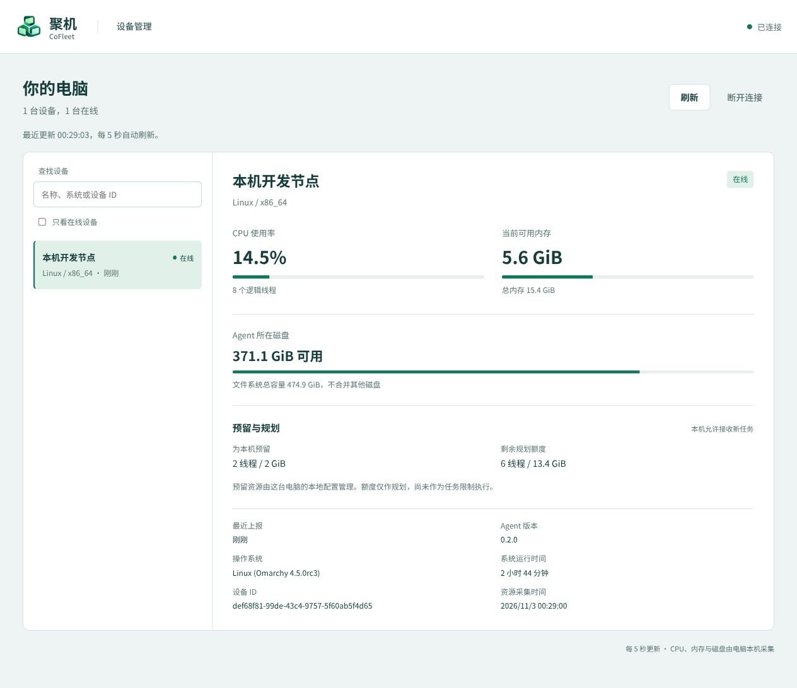

# 聚机 · CoFleet

**懒猫协同电脑 · 让你的电脑一起工作。**

CoFleet 是基于懒猫微服网络的个人开发与应用运行平台构想：由微服统一管理，把现有电脑用于持久开发环境、构建任务和应用部署，让性能较弱的随身电脑也能使用家中设备的资源。

项目目前处于技术原型阶段，已实现设备管理页、真实资源监测、本机预留设置、电脑 Agent、命令行控制和轻量托盘；已增加原生 Linux 的固定测试容器管理、日志和期望状态恢复。0.4.0 增加 code-server 持久开发空间、项目卷、稳定入口和健康状态；0.5.0 增加输入快照、构建日志、无状态应用健康发布与回滚；多节点调度继续按路线图推进。英文名称已选定，尚未进行名称、商标或域名查重；本项目为独立项目，不代表懒猫官方产品。

## 界面示例

0.2.0 设备管理示例，展示资源监测、设备状态和预留规划。图中数据为示例节点的一次快照。

## 目标体验

在家或出门，使用手边电脑登录聚机，在强电脑上的同一个开发空间继续工作；将确定版本的代码交给合适的节点构建，并部署为可访问的应用。

## 核心分工

- **微服管理中心**：统一入口、身份授权、配置存储、节点管理、任务安排与状态核对。初始目标设备为 LC 02。
- **电脑 Agent**：上报能力和资源，操作本机运行环境，执行任务并管理应用生命周期。
- **懒猫现有网络**：承担设备通信和远程访问。可复用已接入懒猫网络的中继，具体接口兼容性和吞吐仍需验证。
- **工作节点**：Linux、Windows/WSL2 等设备，按实际能力提供 CPU、内存、GPU 和存储。

资源统一管理不表示跨机器透明合并内存或显存；单个任务仍需满足所在节点的资源和运行条件。

## 设计文档

- [产品构思](docs/product.md)
- [架构与通信](docs/architecture.md)
- [实施路线与验收](docs/roadmap.md)
- [参考项目与研究依据](docs/references.md)
- [技术选型与原型验证](docs/technology.md)
- [开发与运行原型](docs/development.md)
- [持久开发空间与阶段 2 验证](docs/stage2-workspace.md)
- [构建到部署与阶段 3 验证](docs/stage3-pipeline.md)
- [Linux 原型资源快照](docs/performance.md)
- [参考 lzc-mesh 的控制架构](docs/lzc-mesh-reference.md)
- [懒猫微服部署验证](docs/deployment/lazycat-validation.md)

## 当前决策

先借鉴 Kubernetes 的声明式管理、控制循环和节点自治经验；第一版以指定节点运行及完整工作闭环为目标。服务端和电脑 Agent 以 Rust 为首选；电脑客户端采用独立后台服务与轻量托盘，管理界面优先使用 Web。控制通道参考 lzc-mesh，由 Agent 主动连接微服 WebSocket 中枢。语言选型需经最小原型验证后冻结；是否引入 Kubernetes/K3s、数据库及具体界面框架尚未确定。详见 [技术选型与原型验证](docs/technology.md)。

已将测试版部署到默认微服，验证真实懒猫登录、WSS 控制连接、状态同步和容器重启后的重连；设备服务网关已在本地 omarchy 验证；固定测试容器管理的原生 Docker 验收见 [阶段 1 记录](docs/stage1-docker.md)。项目采用 [MIT 许可证](LICENSE)。参考其他项目的机制不意味着已获得其代码的任意复用授权。

## 运行原型

需要 Rust 工具链。`cargo build --locked --bins` 构建管理端、Agent 和命令行；增加 `--features tray` 同时构建托盘。首次运行需要初始化测试凭据与节点配置，完整步骤见 [开发文档](docs/development.md)。

当前测试身份仅供开发验证，管理端状态保存在内存中。Linux 到懒猫微服的登录与控制通道已实测；Windows/macOS 实机验证和原生后台安装尚未完成。

## 贡献

欢迎通过 Issue 反馈问题或提交 Pull Request。开发、测试与运行步骤见 [开发文档](docs/development.md)；提交前请运行其中的格式检查与测试。请使用脱敏配置和日志，不要在 Issue、提交或测试结果中包含登录凭据与私人设备信息。
