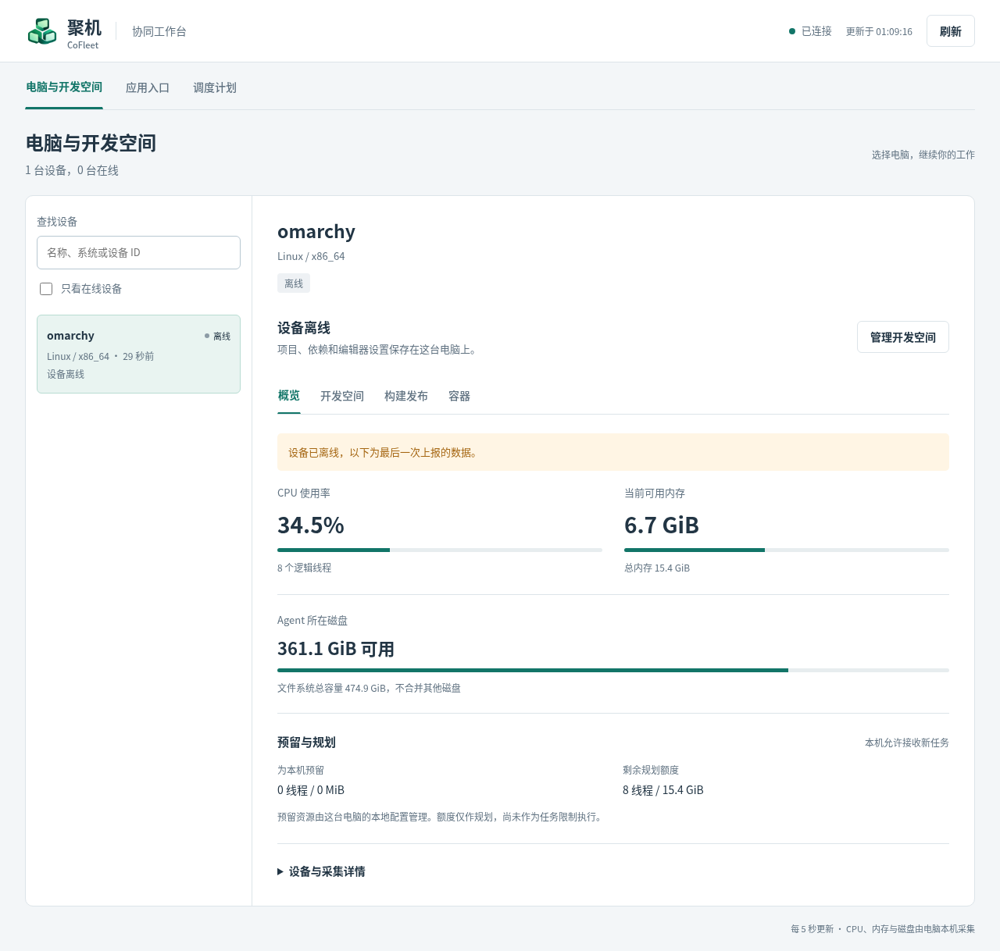

# 长期在线与入口可靠性（0.8.0）

更新日期：2026-11-06。顺序：Agent 用户级自启动 → 离线设备持久化 → 入口操作可靠性与环境识别。

## Linux 当前用户自启动

先初始化节点并确认手动 Agent 可连接。使用与现有 Agent 完全相同的 data-dir、镜像和能力开关；下例路径和镜像需要替换为本机值：

```sh
cofleetctl --data-dir /absolute/node user-service install \
  --agent /absolute/cofleet-agent --no-start \
  --docker --docker-observe --workspace-image sha256:<immutable-image-id> --build-deploy
# 优雅退出原来手动启动的 Agent，再启动用户服务，避免两个进程竞争同一身份。
cofleetctl --data-dir /absolute/node user-service start
cofleetctl user-service status
cofleetctl user-service logs
cofleetctl user-service restart
cofleetctl user-service upgrade --agent /absolute/new-cofleet-agent
cofleetctl user-service stop
cofleetctl user-service uninstall
```

仅观察已有 Docker 应用时，只需 `--docker-observe`；自有开发空间／构建发布需要相应开关和不可变镜像 ID。重复安装必须与已有服务设置一致；升级复用原设置，不能静默关闭能力。安装默认启动，`--no-start` 用于从现有手动进程切换。节点目录必须已初始化，不能借安装创建另一台设备。

服务写入 `~/.config/systemd/user/cofleet-agent.service`，执行文件和安装设置在 `~/.local/share/cofleet/service/`（遵守 XDG 目录）。执行文件独立于源码编译目录，私有权限原子替换。服务使用当前用户、异常退出后 5 秒重启，60 秒内最多启动 5 次；不会提升 Docker 权限。登录用户必须原本具有本机 Docker 访问权限。

不自动开启 linger；服务随用户会话启动，不承诺未登录时运行。懒猫客户端未登录或本机认证暂不可用时，连接重试并展示状态，不能绕过平台身份。升级检查服务和本机 IPC 就绪，失败还原旧执行文件并尝试重启；需用 status/logs 确认回退后的连接。卸载只停止和移除服务注册及安装设置，不删除节点身份、项目、卷、容器或执行文件。不覆盖手工修改或其他工具创建的同名 unit。

Windows 的 `deploy/windows/install-user-startup.ps1` 增加 `-DockerObserve`，仍使用已有的当前用户登录启动路径。没有本次 Windows 实机结果，不把 Linux 通过等同于 Windows 通过。

## 离线设备快照

与入口库共用 SQLite `state.sqlite3`，新增 `device_snapshots` 表，主键为账号与设备 ID。Hello 成功持久化后接受会话；心跳最多每 5 秒落盘一次，显式报告与正常断开保存最新快照。硬断电可能丢失最后一个保存周期的数据。

管理中心恢复时加载为离线，只恢复最近快照及最后在线时间，不恢复控制连接、未完成请求、Docker 日志或浏览器访问授权。资源 age 包含离线经过时间；最后值不能用于在线操作。原节点重连更新同一条记录，不同账号的相同设备 ID 各自隔离。升级前已经丢失的离线设备记录无法追溯，需要节点至少再连一次。

保留离线记录，不再按一天静默淘汰。上限为全局 4096、每账号 256，单快照 16 KiB；超限拒绝新增。损坏或身份不匹配的记录导致加载失败并保留原库供恢复，不自动重建空库。备份应一致地备份 SQLite 主库与 WAL，或停止管理中心后复制。

## 入口操作与账号边界

创建使用客户端生成的固定 UUID；修改、删除、重新绑定使用当前 revision。等待超过 15 秒或网络失败不等于服务端未执行。页面保留原请求，显示“核对并重试”，先读取现状：结果已生效就完成；尚未生效再发原请求；版本或内容冲突则展示说明，不覆盖别人修改。核对未完成前不允许新入口写操作。

待确认请求只在当前页面会话中保存；关闭、刷新或退出后需重新查看入口列表，不能宣称持久任务队列。切换设备分别保留区域反馈；退出与账号变化清除草稿、选择和待确认操作。管理接口响应携带账号范围摘要，前端在消费设备、负载、入口与写操作响应前比对，防止切换账号期间旧响应污染当前页面。摘要不是鉴权凭据，服务端仍使用可信身份核验每次访问。

受信任应用同意与入口创建／重新绑定在同一数据库事务提交；删除同时移除同意。启停、删除或重新绑定会撤销旧访问授权和活跃流，实际访问仍需节点核验。

## Docker 环境身份与迁移

只调用固定本地 socket 的 `docker info/ps/inspect/logs`，不读取任意客户端 context 或远端 DOCKER_HOST。引擎 ID 只以摘要参与环境标识，不发送原始 ID。新标识为 `engine-v2-…`；节点、系统、socket 或引擎身份不同会形成不同环境。

Agent 每 5 秒检查引擎，操作和目标解析前后也核对。引擎不可用时撤销内存授权、标为未验证并拒绝隧道，但不使 Agent 整体下线。变化后清除旧授权与发现缓存，旧入口不能自动关联新引擎；用户选择正确设备、重新发现已发布服务并勾选信任，再点击原入口的“重新确认绑定”。更新 revision，保留原名称、启用状态与 URL。

观察状态写新文件 `docker-observe-v2-state.json`，保留旧版文件不修改，方便回退执行文件。首次升级的环境 ID 会改变，因此旧入口也需一次明确确认。旧 Agent 缺少引擎验证字段时可继续只读发现和日志，但不能新建授权或开启入口隧道，应先升级。

这是周期检查和操作前后核验，不承诺外部变更与正在传输数据之间绝对零竞态窗口；活跃流按授权租约持续复核。原工具仍负责容器部署、启动停止、升级和数据，CoFleet 只观察并转发。共享父域普通 Cookie 的限制仍适用，只加入主动信任的应用。

## 验证

自动化覆盖用户服务参数转义／重复安装／失败升级还原／卸载保留身份，账号隔离的离线快照恢复，Docker 引擎变化关闭流与明确重新绑定、引擎故障时 Agent 在线，以及入口保存响应丢失后的核对、原 ID 重试、revision 保护、旧账号响应隔离和轮询期间状态保持。

### 本机与微服实测

本机 Linux 用户服务已安装、启用，0.8.0 Agent 使用稳定安装路径；受控 SIGKILL 后自动重启并重新连接，同一版本升级命令亦完成就绪检查。原节点配置及旧观察状态文件的摘要不变。

微服主应用已更新 0.8.0，管理和 Agent 原地址保留。停 Agent 后重启管理中心，设备在浏览器中仍为离线且显示最后快照；重新启动 Agent 后同一记录在线，无重复设备，开发空间卷与当前／上一发布版本保持。

两个既有验证入口通过 UI 明确信任并重新绑定，原 URL 保留；HTTP、Cookie 登录、应用 Authorization、WebSocket、禁用后拒绝访问、重新启用需新授权以及 CoFleet 退出关闭 WebSocket 均通过。未将这些自有夹具记作第三方真实项目验收。



结构化结果见 [实测结果](deployment/reliability-validation.json)。发布校准取得 7 篇官方 raw 正文，SHA-256 与上一发布快照一致；`run_as` 的 1.6.0 门槛满足，CLI lint 提示该字段未知，但本次官方原文确认其受支持。来源与摘要见 [规范校准](deployment/reliability-release-calibration.json)，未固定官方 commit，已移除临时签名查询串。

Windows／WSL、第二真实账号、真实电脑重启／注销、平台退出撤销及更多真实应用仍需独立实测。
