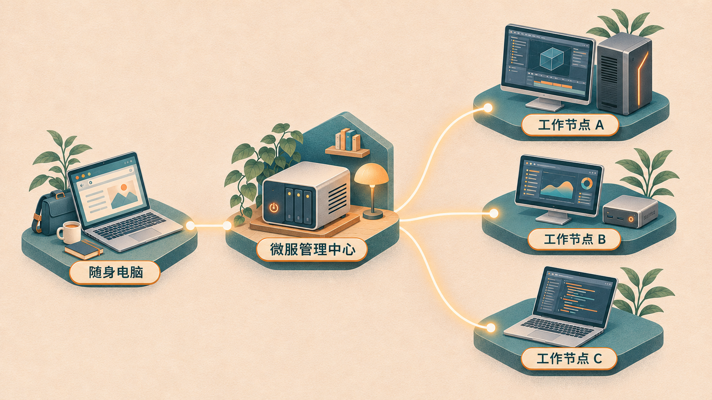
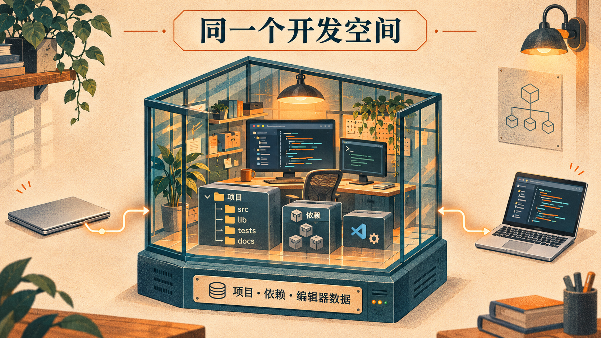
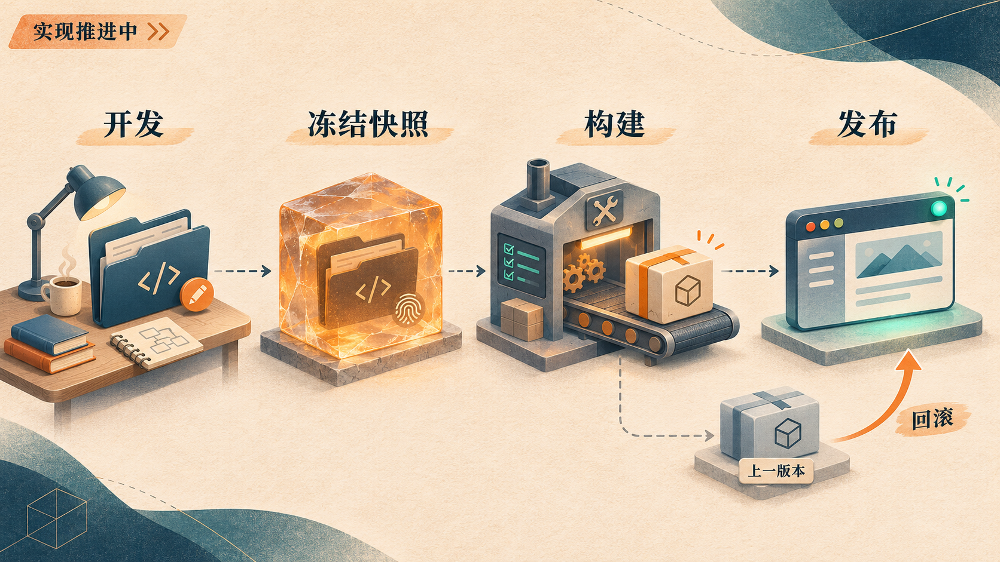

# 聚机 CoFleet：让手边的电脑，接上家里的开发环境

我们想解决的问题，来自一个很日常的场景：家里有性能不错的电脑，出门带着的却是一台轻便、性能有限的设备。代码、依赖和开发工具留在家里，换一台电脑，就要重新准备环境；即使能远程连接，也常常需要自己处理入口、进程、容器和数据的关系。

于是我们开始做聚机，英文名 CoFleet，给它写下了一句简单的描述：**让你的电脑一起工作。**

我们的构思是，以懒猫微服作为统一管理入口，让已有电脑承担开发环境、构建任务和应用运行。用户在手边的电脑上打开浏览器，连接到合适的工作节点，继续同一个项目。这个项目目前仍处于技术原型阶段，但设备管理和持久开发空间已经有了可以运行、可以验证的实现。

## 从一台电脑的性能，转向几台设备的分工

*一个微服管理中心连接多台工作电脑，设备各司其职。图为多节点协同构思示意，不代表已完成多节点调度验收。*

随身电脑适合携带和交互，家中的电脑适合承担较重的计算与存储，微服则适合提供一个持续可达的管理入口。聚机希望把这些特点组织起来。

在我们的设计里，微服负责节点管理、身份校验、状态汇总与访问入口；电脑上的 Agent 负责上报资源、管理本地执行环境，以及执行已经授权的操作。设备通信尽量复用懒猫已有网络能力。

这里的“协同”有明确的物理边界。一个任务依然运行在某台具体电脑上，需要那台电脑具备足够的内存、处理器和运行条件。几台设备的内存与显存不会自动拼成一块，正在运行的进程也不能随意搬到另一台机器。我们首先要做好的，是让资源归属、任务位置和数据位置变得清楚。

## 把开发、构建与运行分成三个对象

随着构思展开，我们把核心工作整理成了工作空间、任务和应用。

**工作空间**保存日常开发所需的代码、依赖、工具和编辑器数据。关闭浏览器后，项目应当还在；换一台终端，也应当能回到原来的环境。

**任务**承担一次有明确输入和输出的工作，例如构建、测试或转码。构建需要记录确定的输入，避免用户继续编辑文件时，产物来源变得无法解释。

**应用**代表一个明确版本的部署，有自己的健康状态和访问入口。开发中的修改与已发布版本分别管理，用户才能知道自己访问的究竟是哪一次产物。

这三个对象串起来，才是我们希望最终完成的体验：在远端开发，冻结一次输入，构建出可追溯的产物，再发布为可以访问的应用。

## 先把设备接进来，再让状态可信

第一步实现的是管理中心、电脑 Agent、命令行工具和轻量托盘。核心后端使用 Rust，管理界面通过 Web 提供。Agent 与托盘是独立进程：退出托盘之后，后台仍然工作；暂停接收新任务，也与停止已有负载分开处理。

管理页已经能够展示真实的 CPU、内存、磁盘和系统信息，并配合本机预留设置，帮助用户规划哪些资源可以交给聚机。这里的预留目前属于预算规划，不能直接视为已经落实的强制资源隔离。

控制连接采用 Agent 主动连接微服 WSS 中枢的方式。Linux 到真实微服的登录、状态同步，以及管理容器重启后的重连，都已有验证记录。平台身份用于隔离不同账号的节点，设备不能仅凭自己上报的字段决定归属。

我们也借鉴了 Kubernetes 的期望状态与控制循环：记录用户想要什么，再持续核对实际运行情况。原生 Linux 上的固定测试容器已经实现启停、日志、请求去重和节点侧状态持久化。网络请求超时后，可以用同一个请求标识重试；管理中心暂时离线，也不会因此停止已有容器。

这些机制看上去离“远程写代码”很远，却决定了系统在断线、重试和重启之后是否还能解释自己的行为。

## 现在，已经能回到同一个开发空间

*终端可以更换，项目、依赖与编辑器数据保留在工作节点。图为概念示意。*

持久开发空间是当前最具体的成果。

我们选择 code-server 作为浏览器编辑器，在原生 Linux Docker 节点上，为每个节点提供一个开发空间。开发镜像包含 Node.js、Python、Git 等基础工具，项目、用户目录、依赖和编辑器数据保存在节点的命名卷里。

开发容器停止或重建后，卷里的内容仍然保留。容器系统层的临时修改则有不同的生命周期，因此依赖应当安装在项目、虚拟环境或用户目录中。我们也提供了项目启动脚本约定，让需要长期运行的项目服务能够在容器启动时重新启动。

这种持久性指向文件、依赖和明确的恢复策略。任意进程的内存状态、每一个交互终端会话，仍不能承诺原样恢复。

用户通过按设备标识组织的稳定入口进入编辑器。管理界面分别展示编辑器与项目服务的健康状态，避免把“编辑器能打开”当作“项目已经正常运行”。

目前的验证覆盖了浏览器编辑和保存文件、终端安装并调用测试依赖、关闭页面后重新进入、真实断点与变量检查，以及开发容器重建后的项目与依赖保留。真实微服域名下的认证访问、代理和调试通道也做了验证。

这些结果让“换一个入口继续同一个项目”有了实际基础。不过，独立外网设备与真实异网切换仍待补测，同一网络下访问微服域名不能代替这项验收。

## 开发体验背后，还有一条数据通道

控制消息和编辑器流量有不同的需求。心跳、状态和操作请求体积较小；编辑器会产生文件传输、终端与 WebSocket 连接，需要单独处理流量和背压。

当前实现保留原有 WSS 控制连接，为开发访问另建独立反向 WSS 数据通道。浏览器请求经过微服认证入口，再由 Agent 转发到已批准开发空间的本机回环端口。数据连接有数量、缓冲与上传大小限制，平台登录凭据也不会继续传入开发容器。

这条路径意味着微服实际承担了业务代理流量。现阶段我们已经记录了 LC 02 的资源与传输观测，但它们只是当前环境下的样本，还不足以形成异地公网或峰值性能承诺。

## 正在推进：从项目快照到应用发布

*构建发布链路正在实现，图中流程不代表已完成整体验收。*

在已经验证的开发空间之上，当前工作区正在加入构建与发布链路。

新增代码尝试从工作空间捕获项目文件，将归档输入计算为 SHA-256 摘要，再交给节点构建，记录任务日志和镜像标识。发布侧加入了健康检查后切换、保留上一版本和回滚的处理；管理界面与命令行也开始提供相应操作。

这里有一个关键约定：用户继续编辑项目，不应悄悄改变已经提交的构建输入。保存快照和摘要，就是为了让一次产物能够对应到明确的源文件集合。完整的可复现构建还需要约束基础镜像、依赖和工具链，不能仅凭源码摘要作出保证。

这部分尚未有与持久开发空间同等完整的验收记录，因此目前应当称为正在推进的实现。首批发布能力聚焦无状态应用；涉及持久数据与数据库迁移时，回滚镜像并不能自动恢复数据。

## 接下来，让这条工作链真正闭合

接下来最重要的工作，是把构建与发布做成可以重复验证的完整流程：明确输入、查看日志、识别产物、检查健康、访问应用，并在失败时给出清楚的状态和恢复方式。

然后再引入第二个执行节点，处理能力匹配、资源预算、数据位置和在线偏好。节点失联时，也需要区分“暂时不知道状态”和“已经停止”，尤其不能盲目复制仍可能在运行的有状态服务。

Windows、macOS、WSL2、后台服务安装与长时间资源基线也仍有待验证。现阶段最扎实的基础，是原生 Linux 节点、真实微服控制通道，以及持久开发空间。

我们希望聚机最终带来的变化很朴素：出门时，手边的设备依然轻便；打开项目时，代码、工具和工作进度已经在那里。家里的电脑有了持续发挥作用的方式，而从开发到发布的过程，也能在同一个入口里被看见、被管理。

---

本文依据截至 2026 年 11 月 3 日的仓库文档与当前工作区代码整理。已验证能力主要参考[实施路线](roadmap.md)、[阶段 1 容器验证](stage1-docker.md)与[阶段 2 开发空间记录](stage2-workspace.md)；构建发布部分依据尚未提交的当前实现描述。聚机为独立项目，不代表懒猫官方产品。
