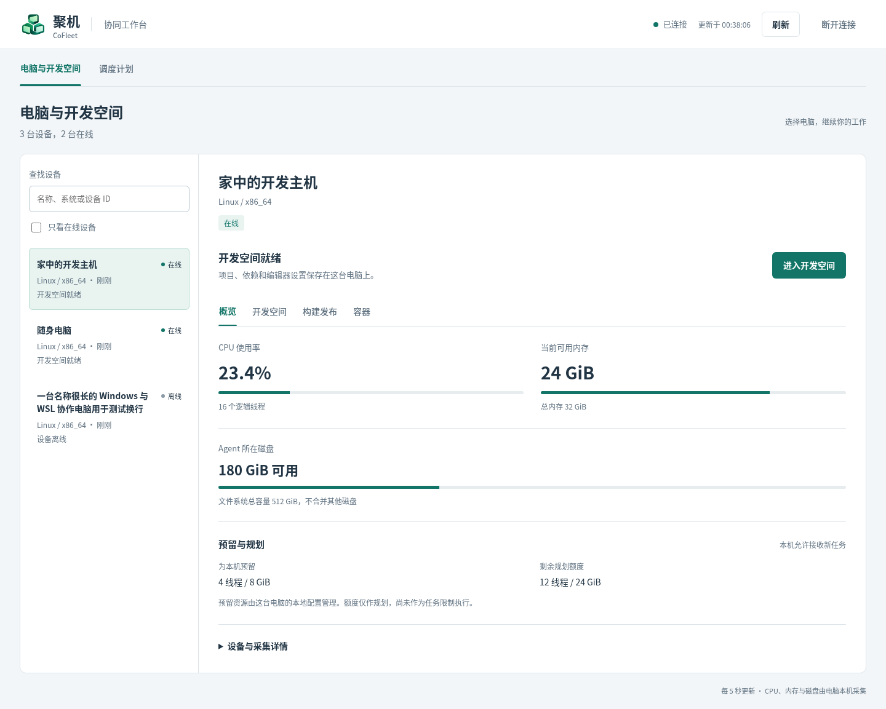
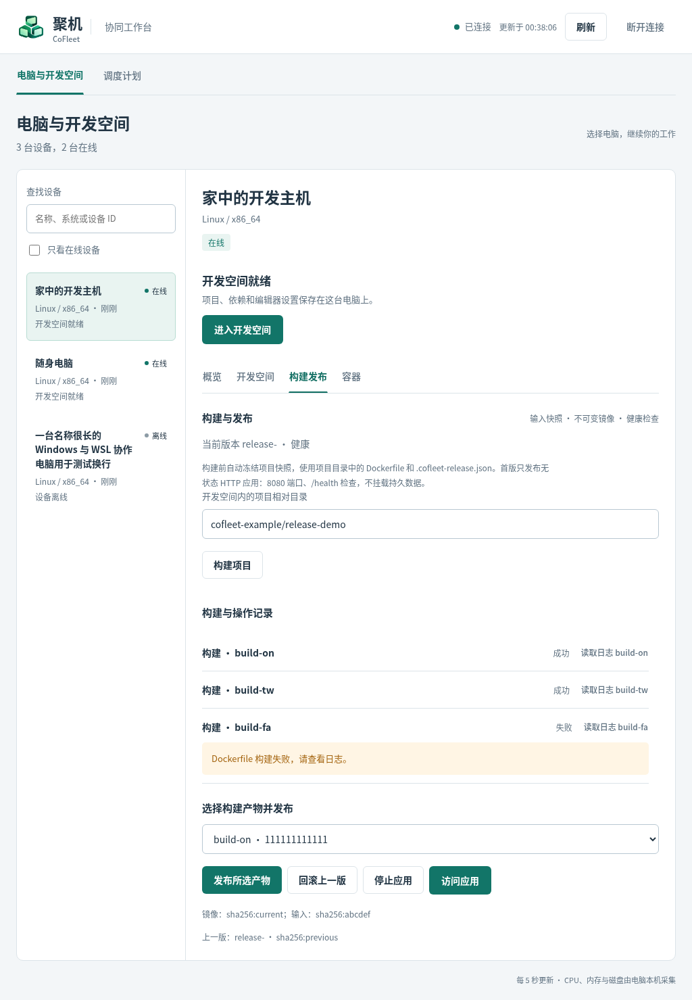
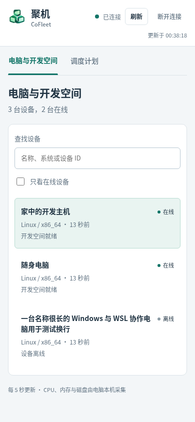
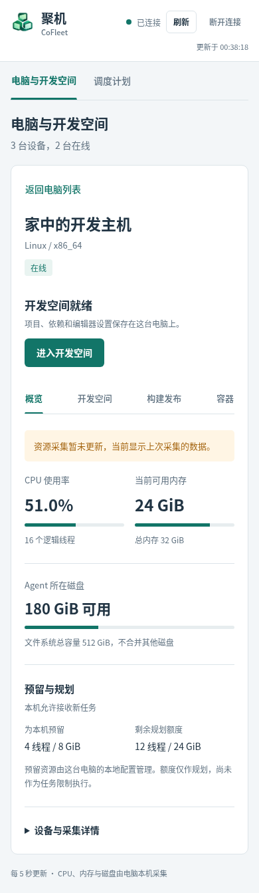

# 管理端界面与交互

对应版本：0.7.0。更新时间：2026-11-04（Asia/Shanghai）。现有截图仍为 0.6.1 的电脑工作台；应用入口页待实机验收后补图。

## 应用入口

0.7.0 一级导航增加“应用入口”。用户先选择声明 `docker_observe` 能力的在线电脑，主动读取最多 50 条一页的容器目录，再从受支持的回环 TCP 发布映射中选择服务。页面支持查看最近 100 行日志、选择 Compose 服务绑定或完整容器 ID 绑定、填写 HTTP/HTTPS 与原管理工具链接，以及添加、打开、禁用和删除入口。

入口显示“等待节点核验／已核验／核验失败／已禁用”和 revision。保存成功不等于可访问；Agent 必须确认当前 Docker 环境、容器身份和端口映射。删除入口的确认文案明确说明不会删除原容器和数据。未配置独立访问域时，添加入口会显示服务端 412，不能退回管理端同源路径。

管理端以“判断电脑能否使用，进入原来的开发空间”为主要路径。页面沿用原生 HTML、CSS 和 JavaScript，不依赖前端框架；本次更新未改变后端接口、认证方式或 Agent 协议。

## 工作台布局

顶部展示连接状态、最近更新时间、刷新操作；开发模式还提供断开连接。一级导航分为“电脑与开发空间”和“调度计划”，默认进入前者。

电脑页面左侧提供名称、系统或设备 ID 搜索，以及在线筛选。设备列表展示在线状态和开发空间状态。右侧保留所选设备的名称、状态及开发空间入口，下方按工作内容分区：

| 页签 | 内容与操作 |
| --- | --- |
| 概览 | CPU 使用率、可用内存、Agent 所在磁盘和预留与规划额度；展开“设备与采集详情”查看标识、GPU、数据位置和采集信息 |
| 开发空间 | 查看编辑器与项目服务状态，启动或停止开发空间、打开项目预览、按需读取日志 |
| 构建发布 | 输入项目目录、构建项目、查看构建与操作记录、选择产物发布，以及访问、停止或回滚应用 |
| 容器 | 查看容器状态，启动或停止固定测试容器，读取测试日志；其他容器仅展示 |

就绪设备的“进入开发空间”入口直接打开编辑器；未就绪时提供“管理开发空间”进入对应页签。预留额度继续由电脑本机配置管理，页面展示的规划额度尚不是执行资源限制。

## 常用操作

### 继续开发

1. 在设备列表中选择电脑，确认其在线状态。
2. 编辑器就绪时点击“进入开发空间”，在新标签页继续工作。
3. 若开发空间尚未运行，进入“开发空间”页签并启动，等待状态更新。节点暂停接收新任务时需先在本机恢复接收任务。
4. 项目预览从开发空间页签打开。停止开发空间前会在操作区域要求确认，项目、依赖和编辑器设置会保留。

### 构建与发布

1. 打开“构建发布”，填写开发空间内的项目相对目录并点击“构建项目”。构建会冻结输入快照，使用项目中的 Dockerfile 和 `.cofleet-release.json`。
2. 在记录中查看结果，按需读取日志。记录区域限制高度，避免较多历史任务挤走发布操作。
3. 构建成功后，在产物选择框中选择目标产物，再点击“发布所选产物”。
4. 应用健康且处于运行意图时提供“访问应用”。停止和回滚会在按钮附近展示确认，说明目标电脑与版本。

当前应用发布能力面向无状态 HTTP 应用。请求被接受与实际执行成功分别展示，执行结果以任务状态和节点上报为准。

### 创建调度计划

通过顶部“调度计划”导航填写负载类型、CPU、内存、GPU 显存和数据位置等要求。提交后查看所选节点及未匹配原因，可释放不再需要的计划。

该页面**仅生成计划，不自动执行构建或容器**。计划保存在管理端内存中，重启后需要重新创建。有状态负载必须填写数据位置。

## 自动刷新与异常反馈

- 每 5 秒读取最新状态，手动刷新仍可使用。页面按变化更新已有节点，保留输入焦点、光标和当前日志滚动位置。
- 页签、项目目录草稿、构建产物选择、技术详情与日志展开状态按设备保存于当前页面内存；切换设备不会串用草稿，退出登录后清除。重新加载页面不会保留这些状态。
- 连接失败时常驻显示错误并保留上次快照，设备标记为“待确认”；离线或采集过期的数据均有说明。连接不可确认时，在线筛选不会隐藏保留的设备快照。
- 未启用的能力显示启用方向；离线、暂停接收新任务、请求处理中或没有可发布产物时，在相关区域说明操作限制。
- 操作结果在所属区域反馈，不被自动刷新覆盖。超时或未确认的变更可用原请求 ID 重试；待确认期间阻止其他冲突变更，避免重复操作。

## 手机与键盘操作

手机端先展示设备列表，选择设备后进入详情，通过“返回电脑列表”继续选择；返回保留搜索条件和当前选中设备。桌面端同时展示列表与详情。

| 设备列表（390px） | 设备详情（390px） |
| --- | --- |
|  |  |

页面提供可见键盘焦点。设备页签支持左右方向键、Home 和 End 切换，展开项使用原生控件；状态同时使用文字和颜色表示，尊重系统减少动态效果设置。

## 截图与验证说明

本文截图来自 `tests/manager_ui.mjs` 的本地 HTTP 模拟数据，不包含真实设备名称、账号、凭据或私有部署地址。截图中的资源数值和任务记录仅用于展示界面，不能作为性能或实机运行证据。

浏览器回归覆盖 1440px、1024px 和 390px 布局、定时刷新输入保持、按设备保存草稿、日志滚动与展开、停止与回滚确认、原请求 ID 重试、调度反馈、连接异常与空状态。运行方式见 [开发文档](development.md#验证)。截图源文件输出到 `.local/ui-preview/redesign/`，文档使用其中的已审核副本。

0.6.1 已完成现有微服验证版的实际升级，页面资源摘要、设备重连、编辑器、项目服务和应用访问的检查结果见 [部署记录](deployment/lazycat-validation.md#061-管理端工作台发布2026-11-04)。本次发布不包含应用商店上架。
