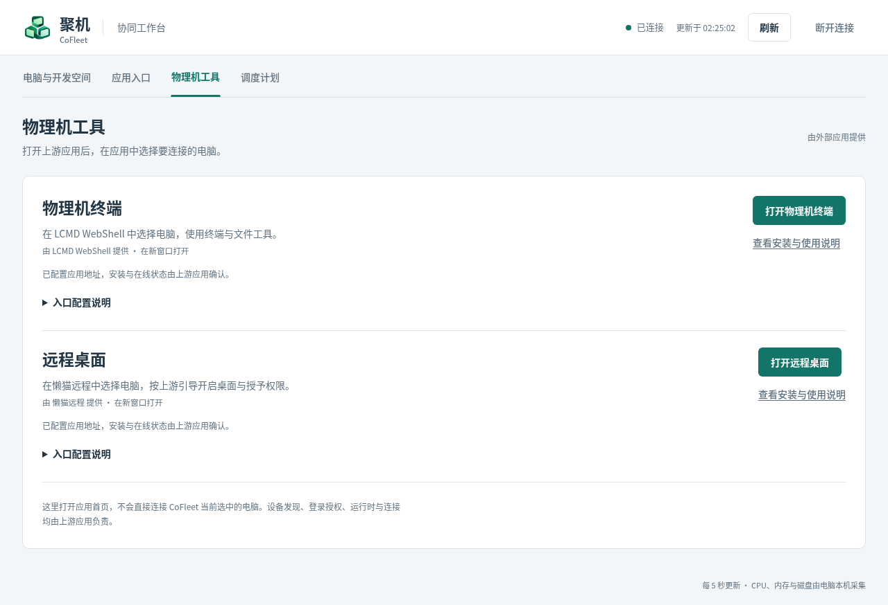

# 物理机终端与远程桌面依赖集成

状态：P1 应用级入口已实现；P0 上游物理机实机验收尚未完成
更新日期：2026-11-06
当前范围：物理机；工作空间接入另行研究

## 决策

CoFleet 不实现终端和远程桌面的数据面，也不复制、分叉或内嵌两个上游项目的能力。物理机的 Shell 依赖 **LCMD WebShell**，远程桌面依赖 **懒猫远程**；CoFleet 只提供发现入口和必要的上下文跳转。

第一版采用**应用级依赖集成**：从 CoFleet 打开上游应用，由上游应用列出并选择物理机。只有在上游提供稳定、公开的设备标识映射或设备深链后，才增加 CoFleet 设备卡片到同一物理机的精确跳转。

这项决策意味着：

- CoFleet 不代理终端 WebSocket、桌面视频、音频或输入事件；
- CoFleet 不保存终端票据、桌面密码、设备访问令牌或系统授权结果；
- CoFleet 不安装、更新、启动或停止上游物理机运行时；
- CoFleet 不按设备名称、IP、操作系统或其他弱特征猜测两个系统中的同一台电脑；
- 上游应用继续负责用户身份、设备归属、在线状态、权限申请和连接生命周期。

## 上游快照

本结论基于下列源码快照，后续实施和验收前需要重新核对：

| 能力 | 项目 | 已读提交 | 包信息 |
| --- | --- | --- | --- |
| 物理机 Shell | [lazycat-microserver-webshell](https://github.com/manateelazycat/lazycat-microserver-webshell) | `434b1b3ecd27492c2ba865a834a6589f0f0af542` | `cloud.lazycat.webshell.lcmd` 1.0.40；最低微服系统 v1.5.2；需要 `lightos.manage` |
| 物理机远程桌面 | [lightos-remote-desktop](https://github.com/ca-x/lightos-remote-desktop) | `0b7b7cccd13dfd8dd6d47f766c7ffda2136adb3e` | `cloud.lazycat.lightos-remote-desktop` 0.1.42；最低微服系统 v1.5.2；需要 `lzcapp.user_delegate` |

CoFleet 当前最低系统版本为 v1.6.0，因此从包声明看没有最低系统版本冲突；这不能替代实际客户端、内核和权限接口兼容性验证。

两个上游仓库当前均使用 PolyForm Noncommercial 1.0.0。依赖上游而不复制代码可以降低代码复用风险，但不能自动解决商业使用、分发或产品捆绑的授权问题；进入商业场景前需要单独确认许可。

## 能力与职责边界

| 事项 | CoFleet | LCMD WebShell | 懒猫远程 |
| --- | --- | --- | --- |
| 展示 CoFleet 节点与工作状态 | 负责 | 不负责 | 不负责 |
| 列举可连接的物理机 | 不维护副本 | 负责 Shell 目标 | 负责桌面目标 |
| 终端运行时与会话 | 不负责 | 负责 | 不负责 |
| 桌面运行时安装、更新与启停 | 不负责 | 不负责 | 负责 |
| 系统屏幕录制、辅助控制等授权 | 不负责 | 不负责 | 负责并引导本机用户 |
| 网络连接、凭据和续期 | 不接管 | 负责自身连接 | 负责自身连接 |
| 应用级打开入口 | 负责 | 被打开 | 被打开 |
| 指定设备精确跳转 | 等待稳定映射 | 具备目标参数，映射待解决 | 等待公开深链契约 |

### LCMD WebShell

源码显示 WebShell Provider 会通过 LightOS Admin 的 `/api/client-instances` 获取物理客户端，并将目标表示为 `client:<client-instance-id>`。前端接受 `target` 或 `name` 查询参数，因此在已经知道稳定客户端实例 ID 时，可以使用类似 `?target=client:<id>` 的入口。

物理机端终端运行时覆盖 Linux、Windows 和 macOS，并由平台父组件管理。终端、文件、SSH、端口转发和指标等能力属于 WebShell，不进入 CoFleet Agent 的远程命令接口。WebShell LPK 导出 `lightos.webshell` 资源，但没有在 LPK 中替 CoFleet 打包或管理电脑端运行时，因此目标客户端是否暴露所需实例与票据接口仍须实机确认。

源码依据：[README](https://github.com/manateelazycat/lazycat-microserver-webshell/blob/434b1b3ecd27492c2ba865a834a6589f0f0af542/README.md)、[物理客户端发现](https://github.com/manateelazycat/lazycat-microserver-webshell/blob/434b1b3ecd27492c2ba865a834a6589f0f0af542/provider/instances.go)、[受管运行时](https://github.com/manateelazycat/lazycat-microserver-webshell/blob/434b1b3ecd27492c2ba865a834a6589f0f0af542/clientruntime/managedruntime/manager.go)、[资源导出](https://github.com/manateelazycat/lazycat-microserver-webshell/blob/434b1b3ecd27492c2ba865a834a6589f0f0af542/lzc-build.yml)。

### 懒猫远程

懒猫远程 LPK 已包含 Linux x64、Windows x64、macOS x64 和 macOS ARM64 的原生运行时及相应编解码组件。PC 客户端主进程中的控制模块常驻，负责设备登记、状态、安装、更新和启停；实际屏幕采集服务只在用户明确开启后运行。

管理页面已经提供物理机卡片、安装或更新进度、权限检查、启停、连接和预览。普通 PC 客户端管理路径不要求 CoFleet 安装独立 `lightos-remoted agent`。当前设备禁止连接自身桌面，必须从另一台设备发起连接。

macOS 需要屏幕录制和辅助功能权限，Windows 需要交互式用户会话；权限只能由被控机本地用户授予。上游目前仍将 Windows/macOS 物理桌面能力视为需要真机继续验证的路径，因此 CoFleet 首轮以 Linux/Omarchy 为验收对象。

源码依据：[管理 LPK 说明](https://github.com/ca-x/lightos-remote-desktop/blob/0b7b7cccd13dfd8dd6d47f766c7ffda2136adb3e/docs/management-lpk.md)、[跨平台宿主说明](https://github.com/ca-x/lightos-remote-desktop/blob/0b7b7cccd13dfd8dd6d47f766c7ffda2136adb3e/docs/cross-platform-host.md)、[设备目标管理](https://github.com/ca-x/lightos-remote-desktop/blob/0b7b7cccd13dfd8dd6d47f766c7ffda2136adb3e/manager/hosts.go)、[设备服务登记](https://github.com/ca-x/lightos-remote-desktop/blob/0b7b7cccd13dfd8dd6d47f766c7ffda2136adb3e/src/agent/network.rs)。

## 设备身份问题

CoFleet 的 `device_id` 是 Agent 初次初始化时自行生成的 UUID，用于 CoFleet 控制面索引。它不等于 LightOS 物理设备 ID、WebShell 的客户端实例 ID 或懒猫远程的目标 ID。

当前已知标识关系如下：

```text
CoFleet device_id
    └─ 没有已验证的公开映射
       ├─ WebShell: client:<client-instance-id>
       └─ 懒猫远程: /desktop/<internal-target-id>/
```

WebShell 已有明确的目标选择器和查询参数，但 CoFleet 目前不知道对应的 `client-instance-id`。懒猫远程公开列表返回内部目标 URL，内部目标 ID 还由设备登记信息计算；该计算属于实现细节，不是跨应用契约。

因此必须遵守以下规则：

1. 不复制懒猫远程内部 ID 的哈希算法；
2. 不以设备名称、IP、平台或在线时间自动绑定；
3. 不把一次人工匹配持久化为未经平台证明的设备身份；
4. 精确跳转必须依赖上游或平台公开的稳定 ID 映射；
5. 映射存在后仍按当前登录用户和设备归属重新授权，不能把目标 ID 当作访问凭据。

## 分阶段方案

### P0：零代码实机验收

先验证依赖本身，不修改 CoFleet：

1. 确认两个 LPK 在目标微服上的安装与版本；
2. 确认 WebShell 能发现 CoFleet 所在的 Linux 物理机并建立 Shell；
3. 确认懒猫远程能显示同一物理机；
4. 在懒猫远程页面内完成运行时安装、权限授权和开启；
5. 从另一台设备连接该物理机，验证真实画面与输入；
6. 记录平台设备 ID、上游目标标识和 CoFleet `device_id`，只用于分析映射，不据此自动绑定；
7. 验证离线、客户端退出、账号切换及权限撤销后的拒绝行为。

源码检查不能代替这一阶段。2026-11-06 使用目标微服的 `lzc-cli app status` 查询，`cloud.lazycat.webshell.lcmd` 与 `cloud.lazycat.lightos-remote-desktop` 均返回 `NotInstalled`。本轮不安装上游、不授予其权限，因此不能声称终端或桌面实机链路可用。

### P1：应用级入口

2026-11-06 按用户明确要求先交付 P1 入口，P0 的上游实机验证继续独立保留。CoFleet 的“物理机工具”导航增加两个明确标为外部能力的入口：

- “打开物理机终端”打开 LCMD WebShell；
- “打开远程桌面”打开懒猫远程。

入口可以位于全局导航或物理机工具区，但在无法传入正确目标时，不应伪装成“已打开当前这台电脑”。上游应用负责继续选择目标。打开新窗口时使用 `noopener noreferrer`，不在 CoFleet URL 或日志中携带上游凭据。

P1 不新增 CoFleet Agent 命令，不改变现有 WSS 控制通道，也不读取上游私有状态目录。

### P1 配置与行为（0.8.1）

管理端部署环境配置真实应用首页地址：

```sh
COFLEET_WEBSHELL_URL=https://<实际终端应用域名>/
COFLEET_REMOTE_DESKTOP_URL=https://<实际远程桌面应用域名>/
```

对应命令行参数为 `--webshell-url`、`--remote-desktop-url`。这是管理端的部署配置，不是 Agent 参数；设置后重启管理端。原生运行时可直接传参；LPK 部署可通过平台的部署配置 override 向 app 服务传入上述环境变量，具体变更由部署管理员操作。默认包不预设上游域名、不请求新的平台权限，也不猜测包名与实际安装域名的关系。

只接受 HTTPS 应用根地址，不接受用户名、密码、查询参数、片段或设备路径。管理端启动时校验；地址仅通过已鉴权的 `/api/whoami` 返回，网页在账号范围校验后使用。CoFleet 不探测上游登录或在线状态，界面“已配置”只代表地址已填写；上游继续验证当前用户。

未配置时按钮禁用，提供上游安装／使用说明及管理员配置指引；不将缺少配置推断为“应用未安装”。管理中心失联或退出时清除可点击入口。入口位于全局工具页，不依赖某台 CoFleet 设备是否在线；打开的是应用首页，不携带设备 ID、账号凭据或深链参数。新窗口使用 `noopener noreferrer`，不会传递 CoFleet 页面的 Authorization 或 referrer。

浏览器测试 `tests/external_tools_ui.mjs` 已通过：导航、轮询与展开状态保持、安全新窗口、无凭据透传、缺少／不安全配置、失联与退出清理、390px 布局。测试使用上游选择页夹具，不等同于真实 Shell、画面或输入验证。原管理端与调度回归、35 项单元测试、8 项协议测试、smoke 与 Clippy 均通过。



本次目标 lzcos 1.6.2+fix.4、CLI 2.0.9，已取得 package／manifest／build／lpk-format／headers 五篇官方原文，摘要与上一发布一致，`run_as` 版本门槛满足；无新增平台权限或路由。记录见 [P1 发布校准](deployment/p1-release-calibration.json)。

0.8.1 已更新目标微服，原管理域名保持。线上验证确认工具导航、缺少配置时的禁用与说明、轮询保留展开状态及手机布局正常；既有 HTTP／登录／WebSocket 访问回归通过。目标微服仍未安装两个上游应用，因此真实物理机连接未验收。结构化结果见 [P1 实测结果](deployment/p1-validation.json)。

### P2：设备级精确跳转

仅在获得稳定契约后实施。优先推动上游提供：

- WebShell：平台物理设备 ID 到 `client:<id>` 的只读查询，或在平台设备 API 中直接返回选择器；
- 懒猫远程：类似 `?device=<platform-device-id>` 的公开深链，或返回稳定平台设备 ID 与目标 URL 的只读接口。

CoFleet 应保存“平台证明的外部标识映射及其版本/来源”，而不是保存连接凭据。映射失效时回退到应用级入口，不猜测新目标。

### P3：工作空间

不在本文范围内。工作空间是容器/执行环境，不必然等同于平台物理客户端；它是否能作为 WebShell 或桌面目标，需要分别研究上游实例发现、容器终端和桌面来源。不得把物理机结论直接套用到工作空间。

## 实机验收清单

### 前置条件

- [ ] 记录微服系统、PC 客户端内核、桌面客户端和两个 LPK 的确切版本；
- [ ] 使用测试账号和非敏感设备，不在报告中记录 Cookie、票据、桌面密码或访问令牌；
- [ ] 至少有一台 Linux/Omarchy 被控机和另一台发起连接的设备；
- [ ] 明确两个 LPK 所需权限，并由用户主动安装和授权。

### WebShell

- [ ] 物理机出现在客户端目标列表；
- [ ] 打开交互式 Shell，确认输入、输出、窗口尺寸变化和重连；
- [ ] 验证文件或端口转发能力时仅使用测试目录和测试端口；
- [ ] 被控机离线后不能新建会话，重新上线后可恢复发现；
- [ ] 切换微服账号后，旧账号目标不可继续访问；
- [ ] 记录是否能从公开接口获得平台设备 ID 与 `client:<id>` 的稳定映射。

### 懒猫远程

- [ ] 未安装运行时时仍显示物理机卡片和明确状态；
- [ ] 用户点击后才安装或更新，未开启时不采集桌面；
- [ ] 本机权限拒绝、部分授权和完整授权状态显示正确；
- [ ] 当前设备的自连接被阻止；
- [ ] 从另一台设备看到真实画面并完成键鼠输入；
- [ ] 离线或停止续期后拒绝新的连接；
- [ ] 账号或网络切换后旧控制授权失效；
- [ ] 更新失败时旧版本仍可用或给出明确恢复状态；
- [ ] 记录公开目标列表是否提供稳定平台设备 ID，而不是反推内部 ID。

### CoFleet 集成门槛

- [x] P1 应用级入口按用户要求先行交付，P0 关键路径仍待真实依赖与第二设备验收；
- [x] 没有稳定映射时，只显示应用级入口；
- [ ] 有稳定映射时，增加负向测试：其他账号、伪造目标、已删除设备和过期映射均不可访问；
- [x] 文档和界面明确标注能力由上游应用提供，不宣称由 CoFleet 实现；
- [ ] 商业使用前完成两个上游许可证的专项确认。

## 主要风险与回退

| 风险 | 处理 |
| --- | --- |
| 上游接口或目标参数变化 | 固定验收版本；升级前重新检查提交和实机行为 |
| PC 客户端没有所需运行时或 API | P0 直接判定阻塞，不在 CoFleet 内补做替代运行时 |
| 设备无法稳定映射 | 保持应用级入口，不做名称猜测 |
| Windows/macOS 权限或会话限制 | 首轮只承诺已通过的 Linux 路径，逐平台记录结果 |
| 上游应用离线或未安装 | 显示依赖说明和打开/安装引导，不接管其生命周期 |
| 许可证不满足商业场景 | 暂停商业捆绑，取得授权或选择许可兼容的依赖 |
| 上游安全边界变化 | 以当前用户和设备归属重新验证，删除失效映射并回退 |

## 当前结论

物理机的依赖式集成在架构上成立。终端和远程桌面能力均已有明确上游负责方，CoFleet 没有必要进入数据面或运行时管理。

当前可以承诺的是“打开上游应用并由上游选择物理机”；不能承诺的是“从 CoFleet 某台设备卡片精确直达上游同一台设备”。后者的阻碍是缺少公开、稳定的跨应用设备身份契约，而不是缺少 Shell 或远程桌面能力。
